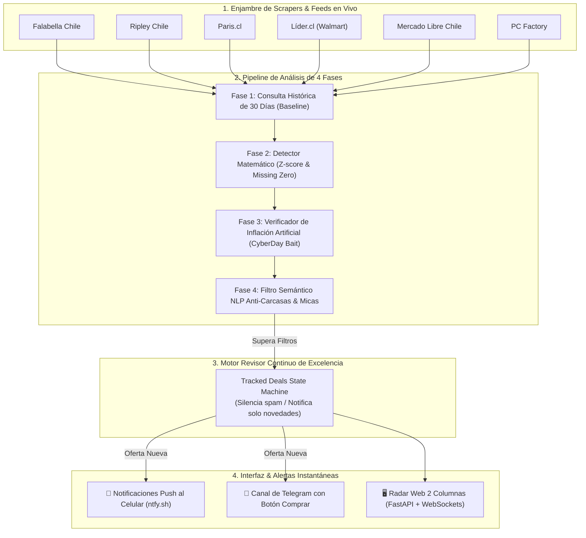

# 🎯 GlitchHunter AI — Radar Inteligente de Errores de Precio en Retail Chileno

[](https://www.python.org/downloads/)
[](https://fastapi.tiangolo.com)
[](LICENSE)
[](https://github.com/Pacortes2021/GlitchHunter_AI/actions)
[-brightgreen.svg)](glitchhunter_ai/tests/)

Plataforma agéntica y colaborativa de **monitoreo en tiempo real, evasión anti-bot TLS (curl_cffi), detección de anomalías de precios (glitches / bugs de digitación) y compras relámpago con modo Sniper 1-Clic** diseñada específicamente para el ecosistema de e-commerce y retail de Chile.

---

## ⚡ ¿Qué problema resuelve GlitchHunter AI?

En eventos como **CyberDay, Black Friday** o en actualizaciones masivas de catálogos nocturnos, los retailers suelen cometer errores críticos de digitación:
* **Missing Zero Bug (~10x):** Un producto de `$999.990` publicado accidentalmente a `$99.990` por la omisión de un cero.
* **Liquidaciones Relámpago:** Descuentos reales sobre el 65% o 80% con stock muy limitado.
* **La trampa de los accesorios:** Scrapers tradicionales confunden una funda o un vidrio templado de `$9.990` con el celular de `$1.000.000`. GlitchHunter cuenta con un **Filtro Semántico NLP** que descarta el 100% de estas trampas.
* **La trampa de la inflación previa (Cyber Bait):** Tiendas que suben un producto de `$100.000` a `$300.000` antes de CyberDay para simular un "66% de descuento". Nuestro **Verificador de Inflación** analiza la mediana de 30 días y rechaza el falso descuento.

---

## 🏗️ Arquitectura del Sistema (Pipeline de 4 Fases)



---

## 🚀 Inicio Rápido (Quickstart)

### 1. Clonar o descargar el repositorio
```bash
cd GlitchHunter_AI
```

### 2. Crear entorno virtual e instalar dependencias
```bash
python3 -m venv .venv
source .venv/bin/activate
pip install -r requirements.txt
```

### 3. Configurar variables de entorno (Opcional)
```bash
cp .env.example .env
```
*(Puedes dejar la configuración por defecto para empezar inmediatamente).*

### 4. Ejecutar el servidor web y radar
```bash
python3 run.py server
```
Abre en tu navegador:
👉 **[http://127.0.0.1:8080](http://127.0.0.1:8080)**

---

## ☁️ Correrlo 24/7 gratis en la nube

Para que el radar no dependa de tu computador, instálalo en una máquina gratuita de Oracle Cloud (región Santiago).
Un instalador de una línea lo deja como servicio que se reinicia solo y respalda la base de datos todos los días.
Paso a paso: [deploy/GUIA_ORACLE_CLOUD.md](deploy/GUIA_ORACLE_CLOUD.md).

## 🖥️ Interfaz Web: Vista de Dos Columnas

La interfaz fue rediseñada en una estética minimalista **Blanco & Verde Esmeralda**:

* **Columna Izquierda — ⚡ Errores de Precio (Glitches Críticos ≥65%):**
  Descuentos extremos, errores de digitación de ceros y bugs de liquidación. Incluye botón directo **"Ir a la Tienda"** con el producto real.
* **Columna Derecha — 🏷️ Ofertas Comerciales Moderadas (40% - 64%):**
  Descuentos atractivos pero reales de catálogo. Permite filtrar por rangos (≥50%, ≥60%) para cazar ofertas interesantes sin mezclar con los errores críticos.
* **Filtros por Tienda:** Filtra instantáneamente por Falabella, Ripley, Paris, Líder, Mercado Libre o PC Factory.
* **Audio ON/OFF:** Sonido de radar al descubrir una nueva oferta vía WebSockets.

---

## 📱 Notificaciones Push en tu Celular (ntfy.sh)

GlitchHunter AI viene integrado con [ntfy](https://ntfy.sh), una app open source gratuita para Android y iOS:

1. Instala **ntfy** en tu teléfono desde Google Play Store o App Store.
2. Abre la app, presiona **+** y suscríbete al tema configurado en tu `.env`:
   * Ejemplo: `glitchhunter_chile_alertas` (o el nombre único que elijas).
3. ¡Listo! Cuando el radar detecta un error de precio:
   * Tu teléfono suena con prioridad máxima.
   * **Al presionar la notificación, tu celular abre inmediatamente la página oficial del retailer con el producto listo para comprar.**

---

## 🔬 Modo LIVE vs Modo Simulado

| Parámetro | `USE_LIVE_SCRAPING=true` (Recomendado) | `USE_LIVE_SCRAPING=false` (Pruebas) |
|---|---|---|
| **Fuente de Datos** | APIs oficiales y catálogos en vivo con stock real en Chile | Dataset de simulación estático local |
| **URLs** | Links 100% reales, vigentes y comprables | Enlaces de referencia creados para tests unitarios |
| **Uso Ideal** | Producción, monitoreo continuo, cacería de ofertas | Pruebas de CI/CD, calibración de IA sin conexión |

### ⚡ Modo Híbrido: Agregadores + Lectura Directa

Falabella, Ripley, Paris y Líder se cubren a través de agregadores (SoloTodo / Knasta), cuyos precios llegan con **~40 minutos de retraso**. Para no perder errores de precio que duran minutos, Falabella y Ripley también se leen **directamente desde la tienda**:

| Función | Variable | Qué hace |
|---|---|---|
| Confirmación en tiempo real | `DIRECT_CONFIRM_ENABLED=true` | Antes de alertar un candidato del agregador, relee el producto en la tienda. Si el precio ya fue corregido o no hay stock, no alerta. |
| Escaneo directo prioritario | `DIRECT_SCAN_ENABLED=true`, `DIRECT_SCAN_INTERVAL_SECONDS=180` | Busca tu watchlist en Falabella y Ripley cada 3 minutos con precios en vivo. |
| Categorías directas (opcional) | `DIRECT_SCAN_CATEGORIES=smartphones,notebooks,televisores,consolas` | Agrega categorías al escaneo directo. Cada página pesa ~1-2,5 MB: usa pocas. |

Si una tienda responde 403/429, muestra una verificación anti-bot o deja de entregar datos, la lectura directa de esa tienda **se pausa automáticamente** (10 min, 20, 40… hasta 2 h) en vez de insistir; mientras tanto se usa el dato del agregador. Paris y Líder siguen solo con agregadores (Paris no publica precio normal en su página y Líder exige verificación anti-bot).

---

## 🧪 Ejecución de Pruebas Automatizadas

El proyecto cuenta con **101 pruebas unitarias e integrales** con 100% de éxito:

```bash
python3 run.py test
# o directamente:
pytest glitchhunter_ai/tests/ -v
```

También puedes ejecutar el diagnóstico de conectividad en vivo:
```bash
python3 run.py diagnose
```

Cubre:
* Benchmark de precios inter-tiendas (SoloTodo & Model Code Extraction) con modulación de confianza y detección de falsa inflación (Punto 2).
* Diagnóstico de scrapers en vivo y sistema de alerta de tiendas ciegas (Punto 1).
* Pruebas de deduplicación y máquina de estados anti-spam con preservación íntegra de ciclos de precios históricos (Auditoría 4).
* Detección de caída de ceros (~10x) y z-scores con certeza matemática calibrada sin distorsión de watchlist.
* Filtro semántico anti-carcasas con casos trampa de Apple, Samsung y consolas.
* Verificación de inflación artificial CyberDay.
* Parser inteligente de moneda chilena (distinción de miles vs. decimales técnicos).
* Aislamiento de notificaciones en modo demo y protección con `X-API-Key` en endpoints administrativos.
* Evasión anti-bot stealth con `curl_cffi` (TLS Chrome impersonation) y meta-crawler SoloTodo.
* Matriz de salud por tienda (`StoreHealthTracker`) con detección de bloqueos y respuestas vacías.
* Modo Sniper para URLs de compra directa en 1 clic y niveles de verificación (`DETECTADO`, `VERIFICADO`, `COMPRABLE`).
* Bloqueo atómico de concurrencia (`threading.Lock`) para evitar carreras entre escaneo manual y automático.
* Endpoints REST y WebSockets de FastAPI.

---

## 🤝 ¿Cómo puedes colaborar y ayudar a desarrollar?

¡Buscamos colaboradores! Si quieres aportar al proyecto, revisa [CONTRIBUTING.md](CONTRIBUTING.md).

### Áreas prioritarias de desarrollo (Roadmap):
1. **Nuevos Scrapers de Retail:** Sumar tiendas como Abcdin, Hites, Sodimac, Easy o Corona.
2. **Auto-Checkout Bot (Headless Browser):** Módulo opcional con Playwright/Selenium para agregar automáticamente al carrito productos con glitches antes de que se agoten.
3. **Bot de Discord:** Crear un webhook o bot interactivo con comandos `/ofertas` y `/glitches`.
4. **Machine Learning Predictivo:** Entrenar un modelo ligero (LightGBM o HuggingFace Transformers) para predecir la probabilidad de que una tienda cancele o despache la compra.

---

## 📄 Licencia

Este proyecto está bajo la licencia [MIT](LICENSE). Libre para usar, modificar y colaborar.
