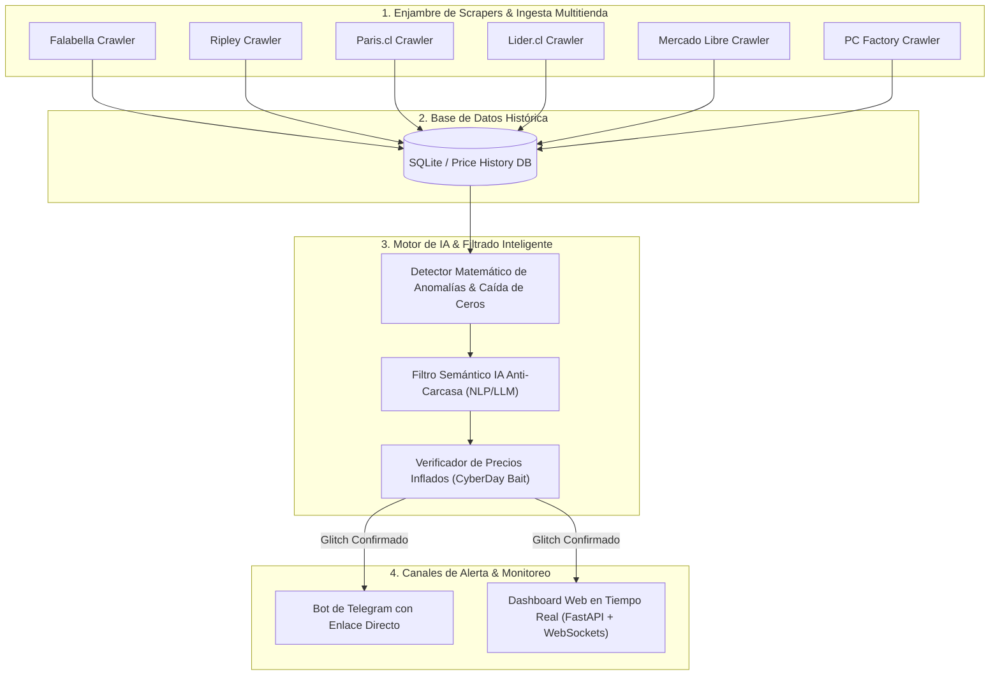

# 🎯 GlitchHunter AI — Plataforma Inteligente de Detección de Errores de Precios

Plataforma agéntica de **monitoreo en tiempo real, detección de errores de precios (pricing glitches / bugs de catálogo) y alertas automáticas** diseñada para el retail chileno.

---

## 🏗️ Arquitectura Modular del Sistema

---

## 👥 Equipo de 15 Subagentes Especializados

| # | Subagente | Rol / Responsabilidad | Módulo Asignado |
|---|---|---|---|
| **01** | `Lead Architect` | Orquestación general, pipeline y CLI maestro | `glitchhunter_ai/run.py` |
| **02** | `Schema Engineer` | Modelos Pydantic v2 fuertemente tipados | `glitchhunter_ai/core/models.py` |
| **03** | `Database Architect` | Motor de persistencia y cálculo de precios base | `glitchhunter_ai/core/database.py` |
| **04** | `Falabella Scraper` | Extractor de catálogo y precios Falabella / CMR | `glitchhunter_ai/scrapers/falabella.py` |
| **05** | `Ripley Scraper` | Extractor de catálogo y precios Ripley | `glitchhunter_ai/scrapers/ripley.py` |
| **06** | `Paris Scraper` | Extractor de catálogo y precios Paris.cl | `glitchhunter_ai/scrapers/paris.py` |
| **07** | `Lider Scraper` | Extractor de catálogo y precios Walmart Líder | `glitchhunter_ai/scrapers/lider.py` |
| **08** | `MELI Scraper` | Extractor de catálogo y precios Mercado Libre Chile | `glitchhunter_ai/scrapers/mercadolibre.py` |
| **09** | `PC Factory Scraper` | Extractor de hardware y tecnología PC Factory | `glitchhunter_ai/scrapers/pcfactory.py` |
| **10** | `Math Anomaly Detector` | Detección de z-score, descuentos > 70% y pérdida de ceros | `glitchhunter_ai/ai_detector/math_detector.py` |
| **11** | `Semantic AI Filter` | Filtro NLP para descartar carcasas, micas y cables | `glitchhunter_ai/ai_detector/semantic_filter.py` |
| **12** | `Inflation Verifier` | Detección de falsos descuentos e inflación previa | `glitchhunter_ai/ai_detector/inflation_verifier.py` |
| **13** | `Telegram Dispatcher` | Bot de Telegram con botones de compra instantánea | `glitchhunter_ai/notifications/telegram_bot.py` |
| **14** | `Backend Server` | API REST y WebSockets en FastAPI | `glitchhunter_ai/web/server.py` |
| **15** | `Frontend UI Radar` | Dashboard Web interactivo en tiempo real | `glitchhunter_ai/web/static/index.html` |
